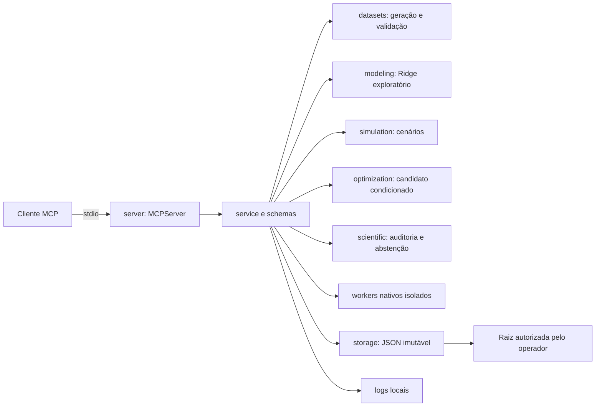

# Arquitetura e decisões

Extensão de 29/10/2026: [ingestão e Growth](universal-ingestion.md) adiciona
universal_schemas, supplied_files, media_validation e GrowthMixin. Artefatos de
fonte/perfil/normalização/canônico/diagnóstico/decisão ficam em reports sob envelope
de integridade, com discriminação de tipo. Lifecycle protege referências; snapshots
de decisão são exclusivos e sequenciais. Arquivos são conteúdo inline limitado,
sem conexões de mídia ou acesso a caminhos recebidos do cliente.

O servidor usa SDK oficial MCP 2.3 e oferece stdio por padrão ou HTTP autenticado em loopback por opção do host. O módulo `server` expõe ferramentas tipadas; `service` normaliza resultados/erros e decide autorização. A matemática não importa MCP. Persistência não importa motores estatísticos. Os adaptadores Meridian, PyMC-Marketing e Robyn usam processos/ambientes isolados; nenhum adaptador de plataforma de anúncios está incluído.

## Contratos e persistência

Entradas Pydantic rejeitam campos desconhecidos, IDs com caminhos, limites inválidos e alocações incompletas. O transporte valida `request` antes de chamar o serviço. `ToolResponse` possui versão, `ok`, `exploratory`, ressalva, `data`, `error` e `warnings`; ambos os esquemas ficam disponíveis na descoberta MCP.

Cada dataset/modelo é um arquivo JSON único com envelope de versão, tipo, SHA-256 e payload. Não se usa pickle, importação dinâmica, SQL, shell nem caminho recebido do cliente. SHA-256 detecta alterações acidentais; não é assinatura de autenticidade. Modelos guardam o hash do dataset, versões das bibliotecas, parâmetros, split, previsões e estado final.

Publicação: gravação exclusiva em temporário no mesmo diretório, flush/fsync e hard link exclusivo para o nome final, seguido da remoção do temporário. O leitor vê um arquivo completo. Colisão falha com `ALREADY_EXISTS`; a geração automática usa UUID. Teste concorrente comprova que somente uma escrita vence. Requer sistema de arquivos com suporte a hard links, como o NTFS testado. Não há fallback que sobrescreva dados. Queda abrupta pode deixar `.pending-*`; não são lidos como artefatos e a remoção manual deve ser feita com o servidor parado.

O artefato modelo serve à consulta e à simulação sem reabrir o dataset. O estado de adstock inclui as mídias realizadas no teste, mas os coeficientes e escalas continuam ajustados apenas no treino. Isso permite prever a partir da última data disponível sem contaminar as métricas de holdout com reajuste.

`audit_model` reabre o dataset somente após verificar a linhagem do modelo. `scientific` reconstrói componentes, executa backtests e sensibilidade, sem persistir uma recomendação de negócio. O otimizador retorna candidato numérico e motivos de abstenção; recommended_spend permanece null. Os adaptadores externos preservam sua própria matemática, configurações e semântica de intervalo, conforme a matriz científica.

## Operação

Logs rotativos de até 1 MB mais três backups registram evento, ferramenta, status e código de falha. Os registros da aplicação não incluem linhas do dataset, credenciais ou caminhos do host. As respostas contêm diagnósticos e avisos estatísticos persistidos. Erros de esquema anteriores à aplicação são respostas MCP do SDK; não necessariamente aparecem no log de eventos do serviço.

Tarefas são locais e síncronas por ferramenta. Um semáforo recusa concorrência de cálculo por instância e BLAS usa uma thread. Workers externos têm timeout, processo separado e encerramento da árvore; no Windows recebem Job Object com limite de CPU e memória. HTTP usa bearer tokens do host, papéis e raiz separada por usuário. Não há fila durável, armazenamento compartilhado distribuído ou identidade corporativa federada. A instância HTTP fornecida escuta somente 127.0.0.1; publicação externa exige nova revisão e autorização.

Artefatos adicionais ficam em `backend_models`, `reports` e `dashboards`. Modelos externos embutem bytes Protobuf, NetCDF ou JSON oficial em base64 sob o mesmo envelope de integridade. Não se usa pickle/RDS. Os workers recebem caminhos privados criados pelo host; o cliente continua fornecendo apenas IDs e dados inline. O R usa também um diretório automaticamente limpo na raiz temporária autorizada do sistema, porque não aceita espaços em seu tempdir interno no Windows.

## Camadas V4 e operação futura

ingestion faz parsing/transformações explícitas; quality produz screens sem alterar dados.
canonical mantém linhagem e semântica por motor; forecasting constrói inputs futuros
sem target; diagnostics classifica somente screens conhecidos. connectors oferece
contratos offline e reconciliação, sem API ou credenciais. lifecycle enumera artefatos
e propõe retenção; exclusão é operação CLI do host, não ferramenta MCP. dashboard_panels
estende o HTML com dados da análise; exports são conteúdo local sem upload.

Futuro serviço público: gateway TLS/OIDC com escopos por organização, banco de jobs
com estados/idempotência e leases, fila durável com retry limitado, workers isolados
por job, quotas de CPU/RAM/tempo/disco, storage por tenant com ACL, cofre de segredos,
métricas sem payloads sensíveis e backup criptografado com ensaio de restore. Separar
estado de autorização do contexto de tarefa e validar tenant ao iniciar e concluir
cada job. O limite do processo local não substitui cgroup/containers/quotas distribuídas.
Esse desenho não foi implantado: requer destino, identidade, custo e autorização.
